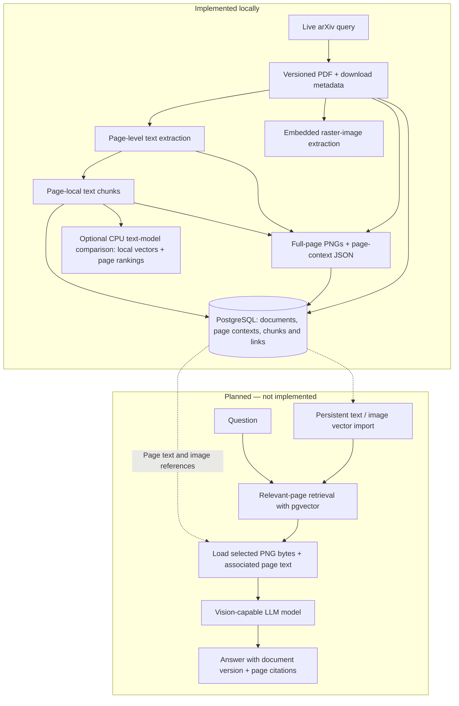
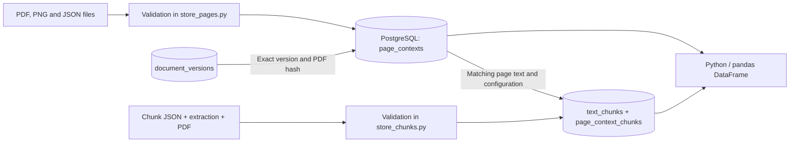

# Search4Cure.AI

Search4Cure.AI is being developed as an illness-specific research workspace,
starting with diabetes, for exploring scientific literature and unresolved
research questions. Papers and traceable evidence are at its center.

Search arXiv for one publication, download its exact PDF version, extract text
by physical PDF page, create traceable text chunks, and extract referenced
raster images with page provenance.

Complete page PNGs preserve diagrams, captions and surrounding layout together.
Each physical page has a JSON record linking its image, extracted text,
text-chunk IDs and exact document version. Page-context snapshots can also be
imported into PostgreSQL.

Metadata search and download use the Python standard library. Text and image
extraction use PyMuPDF. The current environment is tested with Python 3.13.

Local PostgreSQL stores document metadata, page text, text chunks, their page-context
links, PNG references and processing statuses. PDFs, PNG bytes and processing JSON
remain local files. The notebook displays SQL results as
a pandas DataFrame, a table in Python memory.

An optional local comparison computes text embeddings and ranks source pages
in memory. OCR, persistent vector storage, pgvector-backed search, answer
generation, and AWS integration are not implemented yet.

## Contents

- [Research workspace direction](#research-workspace-direction)
- [Pipeline](#pipeline)
- [Setup](#setup)
- [Local PostgreSQL](#local-postgresql), including [pgAdmin](#view-the-database-with-pgadmin)
- [Notebook](#notebook)
- [Run](#run)
- [Extract raster images](#extract-raster-images)
- [Preserve complete page context](#preserve-complete-page-context)
- [Store page contexts](#store-page-contexts)
- [Store text chunks](#store-text-chunks)
- [Store document metadata](#store-document-metadata)
- [Data storage](#data-storage)
- [Record identifiers](#record-identifiers)
- [Processing and import status](#processing-and-import-status)
- [Database schema](#database-schema)
- [Embedding model review](#embedding-model-review)
- [Local text-model comparison](#local-text-model-comparison)
- [Test](#test)
- [Development steps](#development-steps)

## Research workspace direction

Planned views include a searchable paper library, source-linked method comparison
tables, a research timeline, literature-analysis dashboards, a citation graph
and an optional grounded assistant. Dashboards should show how reported methods
and study coverage change over time. Suggested research directions will be
clearly labeled hypotheses with supporting sources, uncertainty and review state.
They will share access to exact paper versions, passages and full-page images.
These workspace views are not implemented yet; the current code provides their
data/provenance and local embedding foundation. See the
[research workspace roadmap](docs/RESEARCH_WORKSPACE.md) for scope, evidence rules
and implementation order. Coverage will describe collected literature rather
than claim a complete history of an illness's research. The scope must distinguish
disease subtypes and study settings; cancer is a possible later research area.
Research suggestions are not verified discoveries or treatment recommendations.

## Pipeline



PDFs, PNGs and processing JSON are currently local files; SQL stores their
metadata and page context. Embedded-image extraction supplements full-page
rendering. The planned answer path must use actual image bytes and associated
text; embeddings or filenames alone do not supply visual evidence.

## Setup

```bash
python3 -m venv .venv
.venv/bin/python -m pip install -r requirements-notebook.txt
.venv/bin/python -m ipykernel install --prefix .venv --name search4cure --display-name "Search4Cure (.venv)"
```

For command-line use without the notebook, install `requirements.txt` instead.

## Local PostgreSQL

Start Docker Desktop. The notebook includes executable cells for these steps,
or run them from the project root:

```bash
.venv/bin/python -m database init-password
docker compose up -d --wait --wait-timeout 60 postgres
.venv/bin/python -m database check
.venv/bin/python -m database init-schema
```

The first command creates `data/postgres/password.txt`, a private password
file excluded from Git. It preserves an existing file and never prints its
contents. No `.env` file is required for this setup; an existing root `.env`
is not used by the Python connection code. Do not replace the password file
while keeping an initialized database volume: creating a new file does not
change the database's existing password.

PostgreSQL is accessible only at `127.0.0.1:55432`. To change the port, set
`POSTGRES_PORT` for both Docker Compose and Python. Compose may also read that
variable from a root `.env`. The image includes pgvector, an extension for
storing vectors. `init-schema` explicitly creates document, page-context and chunk tables, including
on an existing volume; repeat execution preserves its rows. It does not migrate
an existing table with a different definition.
This local development setup uses a bootstrap database administrator account.

Stop PostgreSQL with `docker compose stop postgres`. Its named volume retains
the database; the password file must also be kept. Backup and restore have not
been tested.

### View the database with pgAdmin

For pgAdmin running on the same host as Docker Desktop, register a server with
these non-secret settings from [compose.yaml](compose.yaml):

| pgAdmin field | Default value |
|---|---|
| Host name/address | `127.0.0.1` |
| Port | `55432` (published host port) |
| Maintenance database | `search4cure` |
| Username | `search4cure` |
| Password file path | `data/postgres/password.txt` |

Read the password privately from that local file when connecting; its value is
not included in this documentation. Create it with `database init-password`
before the initial database start, as shown above. Port `5432` is internal to
the PostgreSQL container. If `POSTGRES_PORT` is overridden, use the published
host port instead of `55432`.

After connecting, refresh the database tree and inspect **Schemas → public →
Tables**. The four application tables are created by `database init-schema`.

## Notebook

Open [walkthrough.ipynb](notebooks/walkthrough.ipynb), select **Search4Cure (.venv)**,
and run the cells in order. It shows live outputs for metadata, download,
page-level extraction, text chunks, a page preview, PostgreSQL setup and
connection checks, document metadata import, pandas tables, image extraction
with a reduced preview, complete-page rendering with associated text,
page-context and text-chunk SQL import/repeat checks, and the tests.
Docker must be running for the database cells.

You can also open it in JupyterLab:

```bash
.venv/bin/jupyter lab notebooks/walkthrough.ipynb
```

To execute all cells with live terminal output and save their results:

```bash
.venv/bin/python -u run_notebook.py
```

Each run starts with a real arXiv query. Saved notebook outputs are snapshots
of that run. Subsequent development steps extend this same notebook.

## Run

From the repository root:

```bash
.venv/bin/python -m arxiv_search --query 'all:diabetes'
```

To download the publication returned by a new query:

```bash
.venv/bin/python -u -m download_pdf --query 'all:diabetes' --output-dir data/arxiv
```

Progress messages appear on stderr during the run; the final JSON is written
to stdout. `-u` enables unbuffered Python output.

Each version has its own folder containing a PDF named by its content hash and
a JSON record for each successful retrieval. `data/` is excluded from Git.
Downloads require a known version, use 64 KiB chunks, and are limited to 100 MiB.
A PDF header check does not prove that a parser can read the document.

To extract text, use the `metadata_path` returned by the download command:

```bash
.venv/bin/python -u -m extract_text --metadata path/to/download-record.json
```

Extraction verifies the PDF hash and records its parser configuration, physical
page numbers, empty pages, and processing status. Results are stored beside
the PDF in an `extracted/` folder. No OCR or table reconstruction is performed.

To split an extraction into page-local text chunks:

```bash
.venv/bin/python -u -m chunk_text --extraction path/to/extraction-record.json --max-words 100 --overlap-words 20
```

Chunks retain the document version, PDF hash, physical page, and exact text
offsets. Results are stored beside the PDF in a `chunks/` folder. IDs remain
stable for equivalent content and configuration. Word limits do not enforce
an embedding model's token limit; that check belongs to the embedding step.

On macOS, if Python reports `CERTIFICATE_VERIFY_FAILED` and
`/etc/ssl/cert.pem` exists, prefix the command with
`SSL_CERT_FILE=/etc/ssl/cert.pem` to use the system CA bundle.

Run one search at a time and wait at least 3.1 seconds between runs,
following the [arXiv API rules](https://info.arxiv.org/help/api/tou.html).

## Extract raster images

Use the successful download JSON:

```bash
.venv/bin/python -u -m extract_images --metadata path/to/download-record.json
```

The extractor verifies the PDF hash and stores PNG derivatives in `images/assets/`
beside the PDF. A JSON attempt record links each occurrence to document version,
PDF hash, physical page, image object reference and page coordinates. Reused
images share a PNG file; valid existing files are not rewritten. Soft transparency
masks are applied, and non-gray/non-RGB color spaces are converted to RGB.

No raster occurrences produces `no_images`, not a failed document. Unsupported
or failed occurrences produce `partial`; successful assets are retained for
retry. The CLI exits with code 1 for a partial or failed extraction. A failed
manifest write raises an error; existing assets remain available for retry.

The default per-image limit is 25 million pixels (`--max-pixels` overrides it).
This bounds application decoding checks, not all internal parser memory use.
The pipeline processes one source PDF at a time and caches only extracted-asset
metadata across repeated object references.

Raster occurrences are not necessarily complete scientific figures: text,
vector drawings, captions, clipping and page transformations are not reconstructed.
Inline or unresolved images without an extractable object reference are recorded
as unsupported. This extractor does not fall back to page rendering; complete
pages are rendered separately below. Images are not yet
embedded with CLIP or interpreted by a model. Embedded-image occurrence records
remain local; complete-page PNG references can be imported into SQL below.

## Preserve complete page context

```bash
.venv/bin/python -u -m render_pages --metadata path/to/download-record.json --extraction path/to/extraction-record.json --chunks path/to/chunk-record.json
```

This saves one JSON page record per physical page in `pages/records/`, PNGs in
`pages/assets/`, and a document-level attempt JSON in `pages/`. Records link the
exact page text and chunk IDs after checking document/version/hash consistency
and chunk text offsets. Empty pages are retained. Failed pages remain recorded
without discarding successful pages.

The default is 144 DPI (`--dpi`), RGB, with a 25-million-pixel per-page limit
(`--max-pixels`). Rendering covers the complete visible PDF CropBox, honors
rotation, and includes annotations. Hidden content outside that box is excluded.
Without `--extraction`, text is extracted in the rendering pass; `--chunks`
requires the corresponding extraction record. OCR is not performed.

Text extraction and image rendering handle errors independently. A text error
leaves `text` as `null` and records `text_error`; the PNG can still have
`image_status: rendered`. The attempt is then `partial` (CLI exit code 1).
Empty text is a valid empty result, distinct from an extraction error.

The renderer writes local JSON; the next command imports those page contexts
into SQL. Search and answer generation are later steps:
retrieve relevant pages, load their actual PNG bytes and associated text into
a vision-capable LLM model, then cite document version and physical page.
No model request is made yet; retrieval quality, image resolution and source
support still need evaluation.

## Store page contexts

After database setup, import the parent document using its download JSON,
then import the document-level `metadata_path` returned by `render_pages`:

```bash
.venv/bin/python -m database init-schema
.venv/bin/python -u -m store_document --metadata path/to/download-record.json
.venv/bin/python -u -m store_pages --manifest path/to/page-attempt.json
```

The importer verifies the PDF, page identities, text fingerprints, original
extraction/chunk snapshots and per-page chunk assignments, plus PNG
hashes/dimensions. A composite foreign key requires the same document version
and PDF hash in `document_versions`. Each page is stored in its own transaction;
invalid pages are reported while successful pages are retained for retry.

`read_page_contexts()` returns all variants, including failed ones; this is not
relevance ranking or an automatic choice of evidence. Failed text remains SQL
`NULL` alongside a usable PNG reference. Chunk IDs/configuration are retained;
the next command imports the corresponding chunk text into separate SQL rows.
Invalid import inputs are reported in logs/results and retained source JSON;
there is no persistent SQL import-run audit table yet.

## Store text chunks

First complete the [page-context import](#store-page-contexts), including its
parent-document command. Then use the successful JSON returned by `chunk_text`:

```bash
.venv/bin/python -u -m store_chunks --chunks path/to/chunk-record.json
```

The importer rechecks the original PDF and extraction snapshot, recreates the
recorded word windows and IDs, and requires matching SQL page text, parser and
chunking configuration. `text_chunks` stores each exact chunk once;
`page_context_chunks` links it to matching page-context records. Repeating the
import creates neither duplicate chunks nor duplicate links. A different page
resolution adds links to its new context without copying the same chunk text.

Each chunk and all its new links are written in one transaction. A failed link
rolls back that chunk's writes while preserving other successful chunks. Retry
the same command after correcting the error or importing missing page contexts.
Existing records are preserved. New document versions or chunking configurations
produce separate chunk IDs. Source JSON files must remain available for validation.

`read_chunks()` returns all chunk variants for a document version, without
ranking or configuration selection. `read_chunk_contexts()` follows a chunk to
its physical page, document version and PNG reference. A valid text chunk may
link to a context whose image failed; future vision requests must check image
status and load the actual bytes. No embeddings or model calls occur here.

## Store document metadata

After database setup, import the download JSON from the project root:

```bash
.venv/bin/python -u -m store_document --metadata path/to/download-record.json
```

The importer verifies required fields, timezone-aware retrieval times, PDF size
and SHA-256 before writing. A primary key on `(arxiv_id, version)` prevents
duplicates. The same version and hash return `unchanged`; changed bytes for an
existing version raise a conflict without replacing its row. SQL parameters
are bound separately from SQL commands. Writes use a transaction so failed
inserts can be retried.

The table retains the first imported download record for each version. Later
retrievals remain in local JSON files; they do not update this first snapshot.
Unknown source submission times remain `NULL`. Submission times, source
retrieval times and the database storage time have different meanings; none
establish the exact public availability of a version.

The `downloaded` status describes the download, not successful extraction.
Parser/chunk configuration is retained in page-context snapshots as well as
the corresponding JSON results. Import-run tracking, failed-document records
are later steps.
See [quality queries](sql/quality.sql) for SQL checks.

## Data storage

Downloaded files and processing JSON remain on disk. Before importing page
contexts, the Python code checks their PDF/text/PNG fingerprints and source-page
assignments. PostgreSQL stores document metadata, page text, image references
and processing states. A DataFrame displays SQL results in Python memory.



PNG bytes remain on disk; an SQL path is a reference, not an image input to a
model. See the [developer guide](docs/DEVELOPER_GUIDE.md) for the function-by-function
walkthrough, SQL excerpts and error-handling details.

## Record identifiers

| Identifier | Identifies |
|---|---|
| `page_id` | One physical page: arXiv ID, version, PDF hash and page number |
| `render_id` | That page together with its rendering configuration |
| `context_id` | The page-context result: content, configuration, chunk associations, processing statuses and errors |
| `chunk_id` | One exact page-text window: document version, PDF hash, parser/chunking configuration, physical page, offsets and text |

The following labels are illustrative; actual identifiers are SHA-256 hashes.

| Operation | Page | Rendering | Context | Import result |
|---|---|---|---|---|
| First import | P1 | R1 | C1 | Insert a record |
| Identical repeated import | P1 | R1 | C1 | `unchanged`; no new record |
| Different resolution | P1 | R2 | C2 | Insert a separate record |
| Recovery from a text error, with the same rendering configuration | P1 | R1 | C3 | Insert a separate record; retain the failed-text record |

Chunk IDs exclude attempt paths and times. An identical chunk import keeps its
first row and links. A new resolution creates a context/link, while keeping the
same chunk row. A different chunking policy creates separate chunk rows.

`page_contexts` stores immutable page-context records. Existing records are never
overwritten; changed content, configuration, or processing status creates a new
record. Attempt paths and timestamps do not affect `context_id`; equivalent
imports retain the first record's paths and times.

**The importer preserves existing records.** "Immutable" describes that import
behavior. The database schema does not prevent every direct update or deletion
by a role with the relevant permissions.

## Processing and import status

| Field / result | Values | Meaning |
|---|---|---|
| `text_status` | `extracted`, `empty`, `failed` | Outcome of text extraction; a failure leaves text unknown (`NULL`) |
| `image_status` | `rendered`, `failed` | Outcome of rendering/saving the page image |
| Page record / `page_contexts.status` | `rendered`, `failed` | Whether rendering and page-record storage succeeded; text can still have failed |
| `render_pages()` overall status | `rendered`, `partial`, `failed` | Combined page-rendering, record-storage and text-processing outcome |
| `store_pages()` import status | `stored`, `partial`, `failed` | Database import outcome, independent of the stored processing states |
| `store_chunks()` import status | `stored`, `partial`, `failed` | Chunk/link import outcome; `linked_count` counts newly inserted links |

**`stored` means the database import succeeded.** The stored record may still
describe a text or image processing failure. `partial` means that some page
imports failed while others were inserted or already present.

Text extraction and rendering have independent error handlers. A text exception
does not prevent saving a usable PNG. SQL writes are transactional per page, so
an invalid page does not discard successfully imported pages.

## Database schema

| SQL file | Purpose |
|---|---|
| [001_enable_vector.sql](sql/001_enable_vector.sql) | Enable pgvector during initial Docker database creation; no embeddings are generated |
| [002_document_versions.sql](sql/002_document_versions.sql) | Create one document row per arXiv ID and version |
| [003_page_contexts.sql](sql/003_page_contexts.sql) | Create page-context records, constraints, indexes and the exact document/version/hash foreign key |
| [004_text_chunks.sql](sql/004_text_chunks.sql) | Create text chunks and context links; composite foreign keys enforce the same physical page |
| [quality.sql](sql/quality.sql) | Read-only checks for duplicates, missing source times, processing failures, context variants and orphaned references |

`database init-schema` applies files 002, 003 and 004. File 001 runs on initial Docker
volume initialization; `quality.sql` is run explicitly. Table creation preserves
existing rows but is not a general schema-migration mechanism.

## Embedding model review

The [model review](docs/MODEL_REVIEW.md) identifies the original MiniLM and CLIP
models, their configured dimensions and input limits, and legacy search-routing
issues. The notebook includes an independent inspection example using saved
official metadata and synthetic encoder stand-ins. It does not load models or
compute embeddings. This section can be run independently; its saved review
output has a separate execution history from the earlier pipeline cells.
That inspection predates the actual MiniLM/BGE CPU comparison below. Retrieval
quality still needs confirmed relevance labels and a separate evaluation.

See [alternative model candidates](docs/MODEL_CANDIDATES.md) for the researched
text, biomedical-figure and complete-page retrieval options. The operational
MiniLM/BGE trial does not establish a relevance winner; no replacement is selected.

## Local text-model comparison

Install the optional pinned CPU runtime into the project environment:

```bash
.venv/bin/python -m pip install -r requirements-embeddings.txt
```

Use successful chunk JSON from the earlier pipeline. Repeat `--chunks` to include
another document. A run compares both models on the same validated input:

```bash
.venv/bin/python -u -m embedding_comparison --chunks path/to/chunk-record.json
```

The first run downloads pinned public model snapshots to `data/models/hub`.
Add `--offline` for a repeat using cached weights. Notebook section 15 exposes
the same comparison, including token counts, rejected inputs, example vectors,
timings and ranked source pages. Its default offline setting requires the first
download to be complete. The saved comparison has its own execution history.

Over-limit inputs are recorded and rejected before encoding. A `partial` result
exits with code 1 even if both models loaded successfully; inspect its rejections
and errors. Results, vectors and runtime configuration are saved as new JSON files
in `data/embedding_comparison/runs`. There are no SQL vector writes or embedding
reuse. Development questions are provisional; held-out questions are excluded by
default. Similarity is not accuracy or evidence that a source supports an answer.
See the [comparison guide](docs/EMBEDDING_COMPARISON.md).

To keep MiniLM and split oversized document inputs while preserving their parent
chunks and source offsets, use the optional mode:

```bash
.venv/bin/python -u -m embedding_comparison --chunks path/to/chunk-record.json --model minilm --document-policy split --offline
```

Notebook section 16 compares rejection and splitting on the same corpus. Derived
embedding inputs have separate IDs linked to the original chunk; the SQL source
records remain the reference. Questions still undergo the original length check.
The default comparison policy remains `reject` for reproducible baseline runs.

## Test

```bash
.venv/bin/python -m unittest discover -s tests -p 'test_*.py' -v
```

By default, tests use simulated API responses and generated PDFs; the
tests requiring PostgreSQL or actual model weights are skipped. With local PostgreSQL running, include
actual connection, authentication and document-storage checks:

```bash
S4C_TEST_POSTGRES=1 .venv/bin/python -m unittest discover -s tests -p 'test_*.py' -v
```

The notebook runs this complete suite after starting PostgreSQL.
After installing the optional runtime and caching both models, include their
offline checks as well:

```bash
S4C_TEST_POSTGRES=1 S4C_TEST_EMBEDDINGS=1 HF_HUB_OFFLINE=1 .venv/bin/python -m unittest discover -s tests -p 'test_*.py' -v
```

See [validation results](docs/VALIDATION.md) for the recorded checks.

## Development steps

Each step includes implementation, automated tests, executable notebook examples, and validation notes before the next step starts.
