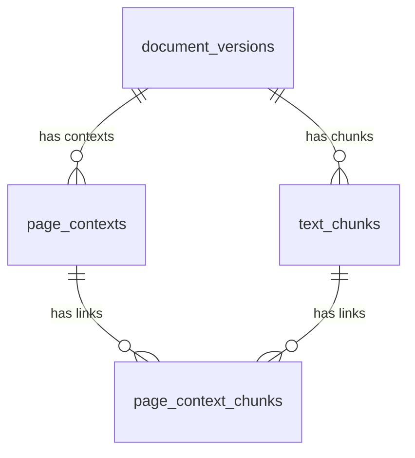

# Data storage developer guide

This guide explains local document, page-context and text-chunk storage. Start with
the [README data-storage overview](../README.md#data-storage) for the diagram,
identifier examples and status tables. Recorded executions and measurements are
kept separately in [VALIDATION.md](VALIDATION.md).

## Contents

- [Storage model](#storage-model)
- [Inputs and prerequisites](#inputs-and-prerequisites)
- [Database connection and initialization](#database-connection-and-initialization)
- [Preparing page records](#preparing-page-records)
- [Import functions in store_pages.py](#import-functions-in-store_pagespy)
- [Text chunks and their page-context links](#store_chunkspy-text-windows-and-their-page-context-links)
- [SQL schema and constraints](#sql-schema-and-constraints)
- [Embedding model review](#embedding-model-review)
- [Verification and current limits](#verification-and-current-limits)

## Storage model

| Table | Stores |
|---|---|
| `document_versions` | One exact publication version, its metadata and PDF fingerprint |
| `page_contexts` | Page text, PNG references, configuration and processing states |
| `text_chunks` | Exact page-text windows, offsets, configuration and source provenance |
| `page_context_chunks` | Links between chunks and matching page-context records |



Each link refers to one chunk and one context. Together, the links express a
many-to-many relationship: a page context can contain several chunks, and one
chunk can belong to several rendering contexts. Composite foreign keys require
both sides to have the same physical `page_id`. PDF and PNG bytes remain on disk.

## Inputs and prerequisites

[render_pages.py](../render_pages.py) produces a document-level JSON manifest
with one record per physical PDF page. Each page links its complete PNG,
extracted text, chunk IDs, exact publication version and PDF hash. The files
remain on disk when their records are imported into PostgreSQL.

Initialize the local database as described in the
[README](../README.md#local-postgresql), then import the parent before its pages:

```bash
.venv/bin/python -m database init-schema
.venv/bin/python -u -m store_document --metadata path/to/download-record.json
.venv/bin/python -u -m store_pages --manifest path/to/page-attempt.json
.venv/bin/python -u -m store_chunks --chunks path/to/chunk-record.json
```

Replace these example paths with the successful download JSON and the
document-level `metadata_path` returned by `render_pages()`. For chunk import,
use the successful JSON returned by `chunk_text()`. A page-record JSON
from `pages/records/` is not the document-level manifest.

## Database connection and initialization

[database.py](../database.py) owns the local connection configuration.

- `create_password_file()` creates the private local password once without
  replacing an existing file. It does not print the password.
- `open_connection()` reads that file, connects to loopback PostgreSQL with
  five-second connection/statement limits, and returns dictionary-style rows.
  It does not automatically load a root `.env` file.
- `initialize_schema()` executes SQL files 002, 003 and 004, in order, inside a
  transaction. Repeat execution preserves rows; it does not migrate an existing
  table with a different definition.
- `check_connection()` runs the read-only server/pgvector check. It is not a
  document-import or retrieval-quality test.

Owned connections are closed through `with` blocks. Storage functions also
accept a caller-provided connection; `nullcontext(connection)` uses it without
closing it. Integration tests use that option to isolate work inside an outer
transaction with forced rollback.

## Preparing page records

The relevant functions in [render_pages.py](../render_pages.py) are:

| Function | Responsibility |
|---|---|
| `_identity()` | Hash consistently serialized identity fields |
| `_load_links()` | Verify document/version/hash consistency, source snapshots, physical page numbers and chunk text slices; group chunk IDs by page |
| `_render_page()` | Check output dimensions, render the visible page to RGB, and save its PNG derivative |
| `render_pages()` | Verify the PDF and process each page, with independent text/image error handlers; save page records and a document-level attempt |
| `main()` | Expose configuration through CLI flags and return a nonzero exit status for incomplete processing |

With no extraction record, text is extracted during rendering. A text exception
leaves `text=None` and records `text_error`, while image rendering still runs.
Empty text is a successful empty extraction. Complete-page rendering respects
the visible PDF CropBox and rotation, includes annotations, and uses the recorded
DPI and pixel limit. It is not OCR or a guarantee of visual legibility.

PNG hashing and atomic storage helpers come from
[extract_images.py](../extract_images.py). Embedded-image extraction remains a
separate operation; a complete-page PNG can contain text, vector drawings and
captions even when no embedded raster image exists.

## Import functions in store_pages.py

### `_hash_value(value)`

This helper checks whether a value has the expected lowercase SHA-256 format:

```python
isinstance(value, str) and re.fullmatch(r"[0-9a-f]{64}", value) is not None
```

A matching string is only structurally valid. Actual file contents must still
be hashed and compared.

### `_validate_png(image, rendering)`

The PNG validator checks its actual file hash, PNG signature and `IHDR` header,
width/height, pixel limit, byte size and successful decoding with PyMuPDF.

```python
width, height = struct.unpack(">II", header[16:24])
```

This reads the two unsigned 32-bit, big-endian dimension values in the PNG
header. The dimension limit is checked before constructing the decoded pixmap.
The check establishes consistency and decodability, not scientific correctness
or continuous availability of the file after import.

### `validate_page(page, document, pdf_hash, manifest_path)`

This function verifies one page and builds the values for its SQL insertion:

1. Check positive physical page number and document/version/PDF-hash provenance.
2. Recompute `page_id` and `render_id` from the identity fields and configuration.
3. Validate text content, hash and status. Failed text must remain unknown with
   an error; an empty result must not be labelled as a failure.
4. Validate the PNG when `image_status` is `rendered`. A failed image must retain
   an error and have no image reference.
5. Check the page status and the format/uniqueness of chunk IDs.
6. Compute `context_id` from the meaningful result fields and prepare JSONB and
   timezone-aware processing-time values for PostgreSQL.

The context identity includes page/render IDs, configurations, text/image
fingerprints and content information, chunk associations, processing statuses
and errors. Attempt paths and processing/retrieval times are excluded. Source
paths and metadata still remain in the first stored `page_record`.

`Jsonb(page)` tells Psycopg to adapt the Python dictionary to PostgreSQL JSONB.
The original source files remain available for provenance checks.

### `store_pages(manifest_path, connection=None)`

This is the import coordinator. Before SQL access, it checks the actual source
PDF hash and page count, requires a complete consecutive page inventory, and
uses `_load_links()` to reopen and validate the extraction/chunk snapshots.

It then requires an existing parent document with matching ID, version and PDF
hash. For each page, it checks the source references, exact chunk-ID assignment,
text and parser against those snapshots before calling `validate_page()`.
A structurally valid chunk ID from the wrong page is rejected.

Each insertion uses a transaction:

```python
with database.transaction():
    inserted = database.execute(INSERT_PAGE_SQL, values).fetchone()
```

With the normal autocommit connection, a page's successful transaction is
committed independently. If the caller supplies a connection already inside an
outer transaction, the inner blocks are savepoints and final durability remains
under the caller's control. Tests deliberately roll back their outer transaction.

The insert binds data separately from the SQL command:

```python
database.execute(INSERT_PAGE_SQL, values)
```

Its duplicate policy is:

```sql
ON CONFLICT (context_id) DO NOTHING
RETURNING context_id;
```

An inserted row returns its ID and is counted as `inserted`. An existing ID
returns no new row and is counted as `unchanged`. No existing row is overwritten.
Changed content, configuration or processing status produces a different
`context_id` and therefore a new record.

Per-page validation/storage failures are logged and returned in the import
result. Other valid pages continue. A global provenance failure, such as a
changed source PDF or extraction snapshot, aborts the import before pages are
written. This is different from storing a valid record that describes an
upstream text/image processing failure.

The result contains per-page outcomes plus `inserted_count`, `unchanged_count`,
`failed_count` and an overall import status. `stored` includes successful no-op
reimports and does not assert that the stored text/image processing succeeded.
There is no persistent SQL import-run audit table yet.

### `read_page_contexts(arxiv_id, version, connection=None)`

This function runs `READ_PAGES_SQL` with bound document/version parameters.
It returns all context variants, including failed processing results, ordered
by physical page, SQL storage time and context ID. It does not rank relevance
or automatically choose a valid evidence record.

The query exposes error fields from JSONB using PostgreSQL's `->>` operator:

```sql
page_record ->> 'text_error' AS text_error
```

The SQL storage time is an internal database time, not the publication time or
the public-availability time of an arXiv version.

### `main()`

The CLI accepts `--manifest`, calls `store_pages()`, and prints its JSON import
result. Exit code `0` means the import result is `stored`; a partial or failed
import returns `1`. A stored processing-failure record can therefore be a
successful SQL import. Database error details/connection credentials are not
included in the CLI's top-level error message.

## `store_chunks.py`: text windows and their page-context links

`validate_chunks(chunks_path)` reopens the extraction/chunk snapshots using
`_load_links()`, verifies the actual PDF fingerprint and page count, and recreates
every window with `_page_windows()`. The supported policy is
`page_word_windows_v1`. Exact text, offsets, word counts, sequence and stable IDs
must match before any SQL access. An unsupported policy is rejected rather than
silently interpreted as the current one.

`store_chunks(chunks_path, connection=None)` finds SQL contexts with the same
document/version/hash, physical page, exact page text, text fingerprint, parser,
chunking policy and chunk-ID assignment. It writes a chunk plus all matching
context links in one transaction. With an existing outer transaction these
blocks are savepoints, as in the page importer. The duplicate policies are:

```sql
-- text_chunks
ON CONFLICT (chunk_id) DO NOTHING
-- page_context_chunks
ON CONFLICT (context_id, chunk_id) DO NOTHING
```

`inserted_count` and `unchanged_count` count chunks; `linked_count` counts new
links. Failed chunks have an error in the result and a log message. A link
failure rolls back that chunk's insert and its other new links, preserving
successful chunks. Import matching page contexts or resolve the storage error,
then retry the same command. Invalid source artifacts abort before writes.

| Import result field | Meaning |
|---|---|
| `inserted_count` | New chunk rows committed by this call, or accepted within a caller's outer transaction |
| `unchanged_count` | Chunk IDs already present; their stored rows are preserved |
| `linked_count` | New context/chunk links written by this call |
| `failed_count` | Chunks whose transaction failed; their new writes were rolled back |

An unchanged chunk can still acquire new links. The following scenarios are
illustrative, not additional measurements:

| Operation | Chunk row | Context link |
|---|---|---|
| First import with one matching context | Insert | Insert |
| Identical repeat | Preserve | Preserve |
| Import another resolution's context, then repeat chunk import | Preserve | Add the new context link |
| Change chunking policy | Insert new IDs | Link to the matching policy's contexts |
| Link failure | Roll back this chunk's new row, if any | Roll back all this chunk's new links |

Changing only PNG resolution adds context links without duplicating chunk text.
A changed document version or chunking policy creates new IDs. Existing rows
keep their first source path and processing time. The parent `chunk_ids` array
is retained; the link table supplies relational access to the actual chunk rows.

`read_chunks(arxiv_id, version)` returns all policies with their configuration,
text, offsets and linked-context count. `read_chunk_contexts(chunk_id)` joins
the links to the original page text and PNG reference. Neither function selects
the best variant or ranks relevance. Valid text may link to a failed-image
context; vision callers must check `image_status` and load/verify actual PNG bytes.

The CLI accepts `--chunks` and prints the import result; `stored` exits with
code 0, while `partial` or `failed` exits with code 1. There are no embedding
or model calls and no persistent import-run audit table.

## SQL schema and constraints

### `001_enable_vector.sql`

```sql
CREATE EXTENSION IF NOT EXISTS vector;
```

Docker runs this initialization file for a new database volume. It enables
pgvector but does not create embeddings or application tables.

### `002_document_versions.sql`

The document table stores the first imported download metadata for each
`(arxiv_id, version)` pair. Its primary key prevents duplicate versions.
It keeps source URLs, PDF path/hash/size, the original download JSON, separate
submission/retrieval times, and the database storage time. Unknown source
submission times remain `NULL`; submission does not prove public availability.

### `003_page_contexts.sql`

The primary key is `context_id`, not `page_id`, because one physical page may
have multiple valid contexts after recovery or a configuration change.

A composite foreign key enforces exact parent provenance:

```sql
FOREIGN KEY (arxiv_id, version, source_pdf_sha256)
    REFERENCES document_versions (arxiv_id, version, sha256)
```

The unique index `document_versions_identity_hash` supports that key. The
`page_contexts_document_page` index supports document/version/page lookups.

Relevant column types:

| Type | Use |
|---|---|
| `TEXT` | IDs, page text, paths, hashes and statuses |
| `TEXT[]` | The page's chunk-ID list; standalone chunk text is not stored here |
| `JSONB` | Full page-record data, including source references, configuration and errors |
| `TIMESTAMPTZ` | Processing and SQL storage times |

The text consistency constraint includes:

```sql
CHECK (
    (text_status = 'failed' AND page_text IS NULL AND text_sha256 IS NULL)
    OR (text_status IN ('extracted', 'empty') AND page_text IS NOT NULL
        AND text_sha256 IS NOT NULL AND text_sha256 ~ '^[0-9a-f]{64}$')
)
```

Image constraints similarly require a path/hash for a rendered image and null
references for a failed image. A page with `status='rendered'` must have a rendered
image, but its text can still have failed. Python adds the source-file/content
checks that these SQL constraints alone cannot establish.

The importer preserves existing records through its identity/insert policy.
There is no trigger or role policy here that universally forbids direct
`UPDATE` or `DELETE` operations by an authorized database user. The current
development account is a bootstrap administrator.

### `004_text_chunks.sql`

`text_chunks` uses `chunk_id` as its primary key. It stores exact text and
Unicode character offsets, physical page, document version/PDF hash, parser and
chunking configuration, source snapshot fingerprint/path and separate processing
and SQL storage times. A composite foreign key references the exact parent
document version/hash. A check requires text length to equal `end_char - start_char`.

| `text_chunks` columns | Meaning |
|---|---|
| `chunk_id` | Stable ID of the exact window and its provenance/configuration |
| `page_id` | Physical PDF page identity |
| `arxiv_id`, `version`, `source_pdf_sha256` | Exact document version and content fingerprint |
| `page_number`, `chunk_number` | Physical page and window sequence within that page |
| `start_char`, `end_char` | Zero-based Unicode character offsets; the end is excluded |
| `chunk_text`, `word_count` | Exact source slice and its non-whitespace word count |
| `parser_config`, `chunking_config` | Structured JSONB configuration used to produce the text and windows |
| `source_chunks_path`, `source_extraction_sha256` | First imported chunk-file path and extraction-file fingerprint |
| `processed_at`, `stored_at` | Chunk generation time and separate SQL storage time |

`page_context_chunks` has primary key `(context_id, chunk_id)`. Its composite
foreign keys require both sides to share `page_id`:

```sql
FOREIGN KEY (context_id, page_id) REFERENCES page_contexts (context_id, page_id),
FOREIGN KEY (chunk_id, page_id) REFERENCES text_chunks (chunk_id, page_id)
```

One chunk can therefore link to several rendering contexts, while a context can
have many chunks. Native foreign keys prevent cross-page links; Python additionally
checks actual page text, fingerprints, configuration and chunk assignments.
Authorized direct database edits are not universally prevented.

### `quality.sql`

These explicitly run, read-only queries inspect duplicate document/context
keys, unknown source times, processing failures, multiple context variants,
and missing/hash-mismatched parent references. The primary/foreign keys should
prevent duplicates and orphans. Multiple contexts for a page may be intentional;
they are not automatically import duplicates. Historical failed contexts remain
visible after a later successful recovery.

Additional queries inspect duplicate chunk/link keys, chunks without links,
inconsistent linked text/configuration and per-policy inventories. SQL
`substring` starts at character 1, so a Python offset `start_char` becomes
`start_char + 1`. Overlapping windows intentionally count some words more than
once; their summed word counts are not a unique-document word count.

## Embedding model review

See [MODEL_REVIEW.md](MODEL_REVIEW.md) for the pinned legacy source, actual model
call paths, official configuration metadata, input-limit and image-crop concerns,
and the boundary for the next implementation step. The current SQL schema stores
no embedding vectors. The independent inspection in notebook section 14 performs
no inference. The subsequent [local text-model comparison](EMBEDDING_COMPARISON.md)
in section 15 computes and validates actual MiniLM/BGE vectors, with results in
local JSON. It includes no SQL vector writes or confirmed relevance evaluation.

## Verification and current limits

See [test_store_chunks.py](../tests/test_store_chunks.py),
[test_store_pages.py](../tests/test_store_pages.py),
[test_render_pages.py](../tests/test_render_pages.py) and the factual
[validation results](VALIDATION.md). The notebook demonstrates real source
processing, repeat imports, SQL DataFrames and a separately labelled synthetic
text-failure/retry example.

SQL stores references to local image files. Moving or deleting those files
does not automatically update immutable records. Asset existence is checked at
import and in the notebook example, not continuously monitored. Repeat imports
also still validate/parse source artifacts; there is no cross-run rendering or
embedding cache.

The implementation does not yet provide vector tables, OCR,
relevance ranking, a historical-availability filter, or image-plus-text model
requests. A future vision request must load selected pages' actual PNG bytes
and associated text. Backup/restore and AWS deployment remain untested.
