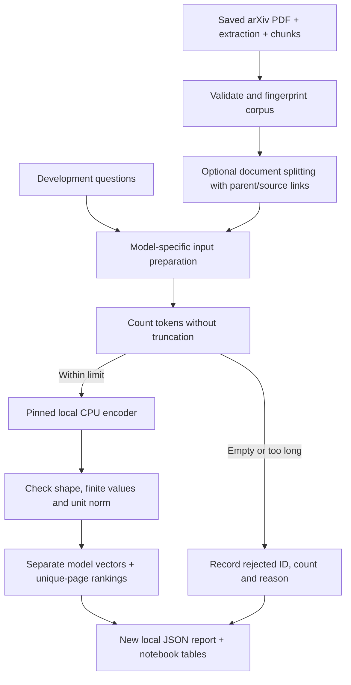

# Local text-model comparison

MiniLM and BGE-small encode validated arXiv text windows and return page rankings
for inspection. This operational trial measures coverage and output integrity;
it does not select a model or measure retrieval quality. See the recorded
[validation results](VALIDATION.md#local-minilm-and-bge-comparison).

## Contents

- [Run](#run)
- [Data flow and functions](#data-flow-and-functions)
- [Configuration and safeguards](#configuration-and-safeguards)
- [Optional token-aware document inputs](#optional-token-aware-document-inputs)
- [Results and limitations](#results-and-limitations)
- [Tests](#tests)

## Run

From the project root:

```bash
.venv/bin/python -m pip install -r requirements-embeddings.txt
.venv/bin/python -u -m embedding_comparison --chunks path/to/chunk-record.json
```

Repeat `--chunks` for another document. The source PDF and extraction must remain
available. The [earlier pipeline](../README.md#run) produces them from a live
arXiv request; this experiment reuses the same validated input for both models.

The optional model dependencies were pinned/tested on Python 3.13 / macOS ARM64.
They are not a cross-platform, hash-locked deployment environment. Install
`requirements-notebook.txt` too for the notebook interface, and restart its kernel
after dependency changes if needed.

The first model run downloads public snapshots into `data/models/hub`. Text is
encoded locally; there is no Google service or paid inference. Safetensors
weights are required and remote repository code execution is disabled. Add
`--offline` after the snapshots are cached. Network errors do not cause synthetic
fallbacks.

Notebook section 15 can run independently on the recorded manifests, or use an
earlier cell's `chunk_result`. Set `COMPARISON_CHUNKS` explicitly to repeat a
frozen experiment. Its default `OFFLINE_MODELS=True` requires a completed first
download. Saved outputs have a separate execution history from earlier sections.

## Data flow and functions



| Function | Responsibility |
|---|---|
| `load_corpus()` | Reuse source/PDF/window validation, deduplicate equivalent attempts and fingerprint exact text/source records |
| `load_questions()` | Select one explicit split and reject empty questions or ambiguous IDs |
| `load_cpu_model()` | Load one immutable model revision on CPU |
| `checked_encode()` | Apply the query prefix once, count special tokens, reject oversize inputs, encode accepted rows |
| `validate_vectors()` | Check row count, dimension, finite numeric values and squared norm near 1 |
| `rank_pages()` | Score validated vectors within one model; keep its best chunk per document-version/PDF-hash/page |
| `compare_models()` | Run models sequentially and retain successful outcomes if another fails |
| `main()` | Publish a new JSON report through the existing atomic metadata writer |
| `token_inputs.prepare_documents()` | Create model-sized inputs with stable parent links and exact source character spans |

## Configuration and safeguards

[`models.json`](../evaluation/models.json) pins revisions, dimensions, sequence
limits and query prefixes. MiniLM uses the raw question; BGE uses its documented
retrieval instruction. Documents have no prefix. Implicit model prompts are
disabled to prevent adding the instruction twice. Encoders request normalized
float32 output, with batch size 16 and two CPU threads by default.

The tokenizer receives `truncation=False`. Counts include special tokens and
the query instruction. Only accepted inputs reach `.encode()`. A tokenizer
warning can therefore appear during preflight even though the oversized input
is excluded from inference. An entirely rejected batch makes no encoder call.
The loaded model dimension and sequence limit must match the registry.

Each model has a configuration fingerprint, tokenizer serialization fingerprint,
and recorded runtime. Different models' vectors remain separate even if both
have 384 dimensions. These records are not an SQL cache.

## Optional token-aware document inputs

The default policy is still rejection. Select a model and enable splitting with:

```bash
.venv/bin/python -u -m embedding_comparison --chunks path/to/chunk-record.json --model minilm --document-policy split --offline
```

[`token_inputs.py`](../token_inputs.py) prepares derived embedding inputs rather
than changing the original word chunks. `split_spans()` first checks the complete
text. Oversized parents are packed at word boundaries, checking the actual
tokenizer count for each candidate with special tokens included. A single
oversized word has a character-prefix fallback: reduce the candidate and recount
until it fits. This does not assume token counts increase monotonically with
prefix length or claim to find the largest possible span.

`prepare_documents()` records a separate input ID, `parent_chunk_id`, page,
document version/PDF hash, parent offsets, and absolute input offsets. IDs include
the model/tokenizer identity, policy version, budget and exact span/text, excluding
attempt filenames. They are repeatable for equivalent inputs; changed policy
identity or spans produce different IDs. Whole fitting parents also get derived
IDs, keeping source chunk identities separate from model inputs.

The inputs partition each parent exactly: no missing characters and no overlap
inside a parent. Existing overlap between parent chunks remains. Unicode
character offsets are zero-based and end-exclusive. The character fallback may
cut a word; preserving literal text is not a guarantee of semantic chunk quality.
An impossible budget raises an error rather than discarding a character.

`checked_encode()` rechecks the derived inputs before inference. Queries are
never split automatically. A long query can still produce `partial` even when
every parent document chunk is represented.

Notebook section 16 measures rejection versus splitting on the same validated
corpus, showing represented parent counts separately from vector counts. It
verifies each parent's full text and source/page/offset assignments. The measured
coverage improvement and tests are in [VALIDATION.md](VALIDATION.md#token-aware-minilm-document-inputs).
SQL vector storage and source relevance evaluation remain later steps.

## Results and limitations

| Report field | Meaning |
|---|---|
| Corpus `sha256` | Fingerprint of ordered validated text/source records, excluding attempt paths |
| `documents` / `queries` | Accepted items/vectors, all token counts, rejections and timings |
| `encode_api_calls` | Calls to `.encode()` for that role, not internal forward-pass counts |
| `encoded_text_count` | Accepted inputs passed for that role |
| `results` | Up to five unique pages per question, with the best chunk and normalized-dot-product similarity |
| `quality_metrics` | `null`; this trial does not evaluate relevance |
| `execution_kind` | Real local inference or explicitly injected synthetic test encoders |
| Model `input_preparation` | Splitting policy, parent/input counts and per-parent derived ID lists; present only for splitting |
| Model `input_preparation_seconds` | Additional source-span preparation time; standard encoding preflight is timed separately |

`complete` means all inputs succeeded; `partial` includes rejected inputs;
`failed` indicates a model-operation error. CLI exit code 0 requires an entirely
complete run. Partial/failed reports preserve available results and distinguish
input rejection from model failure.

Models receive the same corpus but can accept different subsets. A fair relevance
comparison must account for this, for example with an explicit common subset or
a tested token-aware input policy. Splitting is applied only when requested;
no common subset is silently selected.

Questions in [`questions.json`](../evaluation/questions.json) have unreviewed
relevance labels. Held-out questions are excluded by default. No answer is
generated: nearest pages do not prove source support, and the ranker has no
evidence-based abstention. Larger scores across models do not establish better
results. Embedding similarity is not accuracy.

Load time includes library startup, cache access and possible downloads. Encode
time surrounds the library call, excluding token preflight and later Python
vector checks. There is no controlled warm-up, and accepted input counts differ.
Timings are individual observations; peak memory was not measured.

Repeated runs recompute embeddings. SQL vector storage/reuse, pgvector search,
image retrieval, historical filtering, answer generation and AWS remain later
steps. Original artifacts and PostgreSQL rows are preserved.

## Tests

Synthetic tests cover token boundaries, prefix accounting, invalid vectors,
page/source assignment, model failure/retry, immutable revisions, corpus
deduplication, changed source windows, question splits and report creation.
Test vectors do not represent model quality. After caching real weights:

```bash
S4C_TEST_EMBEDDINGS=1 HF_HUB_OFFLINE=1 .venv/bin/python -u -m unittest discover -s tests -p test_embedding_comparison.py -v
```

The opt-in test uses synthetic sentences with real CPU models to verify finite
normalized 384-dimensional output and actual oversized-input rejection. Notebook
path tests cover both starting directories without loading models or pandas
during initial path setup.

The splitting tests additionally verify exact Unicode/whitespace coverage,
absolute offsets, preserved parents/pages/versions, stable derived IDs,
single-word fallback, impossible-budget failures, model selection and continued
query-length rejection. A real offline MiniLM test encodes the derived inputs
of a deliberately oversized synthetic parent.
