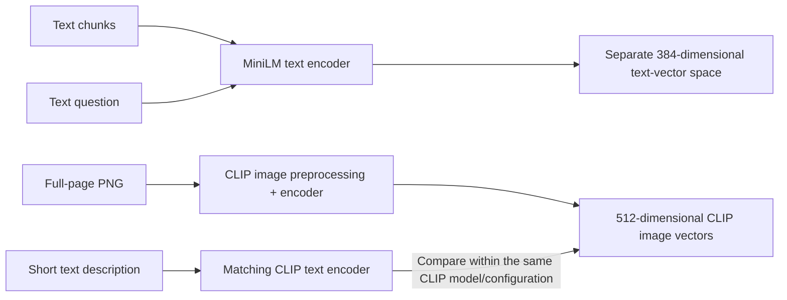

# Embedding model review

Reviewed on November 10, 2026. This is a model/code inspection before embedding
implementation. No model weights were loaded, no embeddings were computed, no
embedding libraries were installed, and no cloud resources were created.

This describes the November 10 inspection. The subsequent real MiniLM/BGE CPU
trial is documented in [EMBEDDING_COMPARISON.md](EMBEDDING_COMPARISON.md); the
historical inspection results below remain unchanged.

## Contents

- [Reviewed source](#reviewed-source)
- [Models and configuration](#models-and-configuration)
- [Actual legacy call paths](#actual-legacy-call-paths)
- [Confirmed issues and limitations](#confirmed-issues-and-limitations)
- [Dependencies](#dependencies)
- [Next implementation boundary](#next-implementation-boundary)
- [Verification](#verification)

## Reviewed source

Relevant legacy files at that exact commit:

- [sbert.py](https://github.com/tubakadriye/search4cure-diabetes-multi-agent-system/blob/8d183adbfd2793a9f1685c19567c86ddc861b7e6/backend/embeddings/sbert.py).
- [clip.py](https://github.com/tubakadriye/search4cure-diabetes-multi-agent-system/blob/8d183adbfd2793a9f1685c19567c86ddc861b7e6/backend/embeddings/clip.py).
- [pdf_processing.py](https://github.com/tubakadriye/search4cure-diabetes-multi-agent-system/blob/8d183adbfd2793a9f1685c19567c86ddc861b7e6/backend/multimodal/pdf_processing.py).
- [rag_retriever.py](https://github.com/tubakadriye/search4cure-diabetes-multi-agent-system/blob/8d183adbfd2793a9f1685c19567c86ddc861b7e6/backend/retriever/rag_retriever.py).
- [index_utils.py](https://github.com/tubakadriye/search4cure-diabetes-multi-agent-system/blob/8d183adbfd2793a9f1685c19567c86ddc861b7e6/backend/db/index_utils.py).
- [article_agents.py](https://github.com/tubakadriye/search4cure-diabetes-multi-agent-system/blob/8d183adbfd2793a9f1685c19567c86ddc861b7e6/backend/sub_agents/article_agents.py).

## Models and configuration

| Role | Actual model identifier | Configured output dimension | Input configuration |
|---|---|---:|---|
| SBERT text | `sentence-transformers/all-MiniLM-L6-v2` | 384 | Sentence Transformers sequence limit: 256 tokens |
| CLIP text | `sentence-transformers/clip-ViT-B-32` | 512 | Text limit: 77 tokens |
| CLIP image | The same CLIP model | 512 | Resize and center crop to 224 × 224 pixels |

These are documentation/configuration findings, not measured inference shapes.
The original wrappers use the short names `all-MiniLM-L6-v2` and `clip-ViT-B-32`.
Sentence Transformers resolves those names to its own model organization, as
described in its [loading documentation](https://www.sbert.net/docs/sentence_transformer/pretrained_models.html).
`all-mpnet-base-v2` appears only in a comment in `sbert.py`; it is not the model
constructed by that code.

Official model metadata was fetched with HTTPS verification enabled. The exact
responses' configuration values, URLs, content hashes, retrieval time and model
revisions are recorded in [model_review.json](model_review.json):

| Model | Inspected model revision |
|---|---|
| MiniLM | `1110a243fdf4706b3f48f1d95db1a4f5529b4d41` |
| CLIP | `327ab6726d33c0e22f920c83f2ff9e4bd38ca37f` |

The recorded revisions identify the configuration inspected now. They do not
establish which revisions produced any old MongoDB vectors: the legacy code
does not pin them.

MiniLM's [model card](https://huggingface.co/sentence-transformers/all-MiniLM-L6-v2)
describes 384-dimensional sentence/paragraph embeddings and default truncation.
Its [Sentence Transformers configuration](https://huggingface.co/sentence-transformers/all-MiniLM-L6-v2/blob/1110a243fdf4706b3f48f1d95db1a4f5529b4d41/sentence_bert_config.json)
sets 256, even though the underlying transformer architecture has 512 positions.
The configured modules perform mean pooling followed by normalization. Pooling
combines token representations into one vector; normalization scales its length.

CLIP's [configuration](https://huggingface.co/sentence-transformers/clip-ViT-B-32/blob/327ab6726d33c0e22f920c83f2ff9e4bd38ca37f/0_CLIPModel/config.json)
sets a 512-dimensional projection and 77 text positions. The vision backbone's
768 hidden features are internal; they are not the final embedding dimension.
Its [image processor configuration](https://huggingface.co/sentence-transformers/clip-ViT-B-32/blob/327ab6726d33c0e22f920c83f2ff9e4bd38ca37f/0_CLIPModel/preprocessor_config.json)
enables resizing, center cropping and normalization.

## Actual legacy call paths

`process_pdfs_and_upload_images()` sends each complete nonempty page text to both
wrappers. It also renders the whole page, uploads its PNG to Google Cloud Storage,
and sends the rendered image to CLIP. The fields written are:

| Stored field | Input | MongoDB index dimension |
|---|---|---:|
| `sbert_text_embedding` | Whole page text → MiniLM | 384 |
| `clip_text_embedding` | Whole page text → CLIP | 512 |
| `clip_image_embedding` | Rendered whole-page image → CLIP | 512 |

`get_sbert_embedding()` and `get_clip_embedding()` call `.encode()` and convert
the result to a Python list. They do not check token counts, dimensions, finite
values, or model revision. Both instantiate the model when the module is imported.

`vector_search()` selects its query encoder and stored field as follows. This
routing was reproduced with synthetic encoder results and an empty fake
collection; no real model or MongoDB service was involved:

| Requested mode | Encoder actually called | Field actually searched |
|---|---|---|
| `sbert`, text input | SBERT | `sbert_text_embedding` |
| `clip`, text input | CLIP | `clip_text_embedding` |
| `clip_image`, image input | CLIP | `clip_image_embedding` |
| `voyage`, text input | SBERT | `voyage_embedding` |

The standalone `embed_docs_with_clip()` helper writes a different field,
`clip_embedding`. Its call in `main.py` is commented out; it is not the active
PDF page-embedding path. Uploaded standalone images also use `clip_embedding`,
which does not match the page-image field in the shown multivector index.

## Confirmed issues and limitations

| Finding | Evidence | Consequence for the new implementation |
|---|---|---|
| Whole-page text is passed without a token-length check | Legacy PDF processing and wrappers | Check actual model-token counts before encoding |
| Short word windows do not guarantee compliance with token limits | Current chunker counts whitespace-separated words; model tokenizers use their own subdivisions | Preserve offsets; define an explicit policy for oversize chunks instead of silently truncating |
| Text-to-image tool routes text queries to `clip_text_embedding` | Tool passes `model="clip"`; isolated retriever execution selects that field | Separate query encoder from target field; CLIP text queries must target image vectors for text-to-image search |
| Optional Voyage mode uses the SBERT encoder | Isolated legacy retriever execution | Do not copy this mode into the new implementation |
| Default CLIP preprocessing center-crops page images | Official image processor configuration | A saved full-page PNG can contain content excluded from the CLIP input; evaluate image-search coverage separately |
| Legacy dependencies and model revisions are unpinned | Requirements and model constructors | Pin and record the tested model/runtime configuration |

The maintained Sentence Transformers
[CLIP wrapper](https://github.com/huggingface/sentence-transformers/blob/main/sentence_transformers/models/CLIPModel.py)
requests text truncation. The installed library version in the original runtime
is unknown, so its exact historical truncation/error behavior was not executed.
No token counts for current chunks were measured in this review. A 100-word
window must not be reported as guaranteed to fit MiniLM or CLIP.
Token budgets must account for tokenizer-added special tokens; that behavior
will be checked with the selected runtime before encoding.

CLIP text and image vectors share a model-specific space, enabling cross-modal
comparison, as described in the [model card](https://huggingface.co/sentence-transformers/clip-ViT-B-32).
MiniLM vectors belong to a different space. Equal dimensions alone would not
make unrelated models compatible either.

Full-page PNGs must remain available for the later image-plus-text answer step.
A CLIP vector or its small cropped model input is not a substitute for the
actual selected page image. Scientific relevance, small-text recognition and
answer support have not been evaluated.

## Dependencies

The standalone embedding wrappers require Sentence Transformers and its model
runtime; the image path also uses Pillow. The legacy requirements contain
`sentence-transformers` and `Pillow` without versions. Its surrounding pipeline
and retriever import Google Cloud Storage/Gemini/ADK and MongoDB code.

The models can be loaded through local libraries, without Google service
credentials. Their [official usage examples](https://huggingface.co/sentence-transformers/clip-ViT-B-32#usage)
load public models through Sentence Transformers. Initial artifact download
requires access to the model host, or a complete compatible local snapshot.
Local model inference has not yet been verified in this project environment.

The current `.venv` has no installed `sentence-transformers`, `transformers`,
`torch`, `tokenizers`, `huggingface-hub` or `Pillow` distribution. A default
Hugging Face cache contains a MiniLM snapshot with tokenizer/configuration files;
the reviewed CLIP model directory is absent. Cache presence does not prove that
weights are complete, match the newly inspected revision, or can run.

Current [installation documentation](https://www.sbert.net/docs/installation.html)
recommends Python 3.10+, PyTorch 2.2+ and Transformers 5.0+ and describes image
extras. These are upstream recommendations, not a tested dependency lock for this
Python 3.13 project. Runtime/package compatibility still needs verification.

## Next implementation boundary

MiniLM remains the reference baseline. The [candidate comparison](MODEL_CANDIDATES.md)
describes possible replacements; the active model has not been selected through
a project evaluation. The first MiniLM trial must check token limits before
encoding, verify 384 finite output values, and record model ID/revision,
tokenizer, pooling/normalization, runtime and any preprocessing policy. Keep CLIP
vectors and their configuration separate when image search is introduced later.

The proposed search wiring below is not implemented yet:

New chunk vectors will be built from the versioned SQL chunks. Old MongoDB vectors
were not accessed, and cannot be presumed reusable: they describe whole pages,
have no pinned model/runtime provenance in the inspected code, and do not carry
the new chunk IDs. This is a planned rebuild, not a completed migration.

Repeated encoding should use the exact chunk plus embedding configuration as its
reuse key. The vector-table schema and oversize-chunk policy are not implemented
in this review.

## Verification

The [walkthrough notebook](../notebooks/walkthrough.ipynb) includes an independent
model-review cell. It reads the saved real metadata and pinned legacy source,
checks configured dimensions against the old index, and reproduces encoder/field
routing with explicitly synthetic stand-ins. It needs Git history, but no model
libraries, credentials, network or database connection.

This cell verifies metadata and routing, not actual embedding dimensions at
runtime. See [VALIDATION.md](VALIDATION.md#embedding-model-inspection) for executed
checks and the remaining limits.
