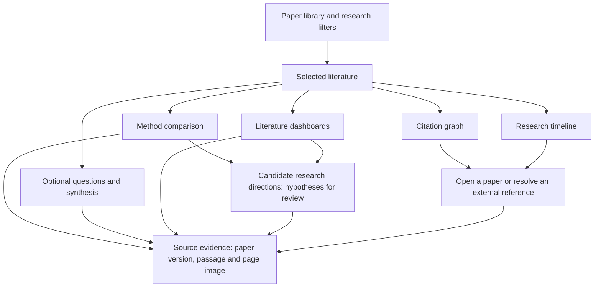

# Research workspace roadmap

Search4Cure.AI is intended as an illness-specific research workspace for exploring
unresolved questions about disease mechanisms, prevention, treatment and cure.
Diabetes is the initial focus; cancer is a possible later research area. The
product centers on papers, methods, evidence and their relationships, with
dashboards for literature analysis and suggestions for research directions.
A grounded conversational assistant is one optional interface. This document
is a plan; the views below are not implemented yet.

## Contents

- [Illness-specific scope](#illness-specific-scope)
- [Research views](#research-views)
- [Literature dashboards](#literature-dashboards)
- [Method comparisons](#method-comparisons)
- [Suggested research directions](#suggested-research-directions)
- [Citation graph](#citation-graph)
- [Research timeline and coverage](#research-timeline-and-coverage)
- [Implementation order](#implementation-order)
- [Next bounded step](#next-bounded-step)

## Illness-specific scope

Start with one explicit research question and a defined disease subtype, then
expand the working collection. Disease labels alone are too broad for useful
comparisons: retain subtype, population, disease stage, study setting and
research objective where reported. Keep human, animal, laboratory and
computational evidence distinguishable.

The motivation is to investigate unresolved needs. Do not assign a blanket
"no cure" label to every disease or subtype, or treat disease control, remission,
prevention and cure as interchangeable outcomes. Preserve the paper's stated
outcome and definition; missing definitions remain unknown. The workspace
supports research exploration, not individual treatment recommendations or a
claim that its suggestions will discover a cure.

## Research views

| Planned view | Research task | Evidence requirement |
|---|---|---|
| Paper library | Search/filter collected papers, select a working set and inspect versions | Source identifiers, provenance, processing state and scope of available full text |
| Method comparison | Compare approaches across selected studies | Every extracted field links to the exact source version, page and passage/table |
| Citation graph | Follow references backward and citing works forward | Source-backed directed links, resolved identifiers and explicit unresolved references |
| Research timeline | Explore studies and methods over time | Reliable dates with their meaning and precision retained |
| Literature dashboard | Examine method trends, study coverage and reported outcomes for a scoped illness question | Visible denominators, source coverage, date semantics and review state |
| Research directions | Inspect possible gaps, conflicting findings and proposed follow-up questions | Supporting and conflicting passages, scope limits and explicit hypothesis status |
| Evidence viewer | Inspect the retrieved text beside its full-page PNG | Exact page/version/PDF hash and actual local image bytes |
| Optional assistant | Ask questions about the selected literature | Retrieved evidence, source support checks and an explicit insufficient-evidence response |

The same selection and evidence viewer should connect the views. Selecting a
comparison cell opens its supporting page; selecting a graph node opens the
paper. Tables and citations should eventually be exportable with provenance.

## Literature dashboards

Use the same disease/question filters and selected corpus across all charts.
Clicking a chart element should reveal the contributing papers, then the source
passages and page images. Show the search scope, last retrieval time, missing
data and provisional extraction counts alongside the charts.

| Planned panel | Research question | Interpretation constraint |
|---|---|---|
| Publication timeline | Which collected studies appeared in each period? | Counts describe the indexed corpus; label the date type and keep unknown dates visible |
| Methods over time | Which reported approaches appear, persist or change? | Use a documented method taxonomy and review labels; papers can use multiple methods |
| Method × dataset/population matrix | Where have approaches been studied together? | An empty cell means no matching records in this collection, not proof that research does not exist |
| Study-design distribution | What kinds of evidence are represented? | Keep human, animal, laboratory, computational and review studies separate; counts do not establish quality |
| Reported-outcome table or plot | What did comparable studies report? | Plot together only explicitly compatible endpoints, units, populations and settings; retain uncertainty |
| Citation network | How do the collected works connect through references? | Links describe citations, not agreement, causality or treatment effectiveness |

Start with a small source-linked table and one methods-over-time chart after
the underlying extraction fields have been reviewed. Avoid presenting an
automatically inferred trend as an established history of the whole field.

## Method comparisons

The first comparison should describe a small set of papers, with these fields:

| Field | What to preserve |
|---|---|
| Paper and date | Stable identity, version, publication/submission date and its precision |
| Research question and study type | What the study investigates; distinguish clinical, computational, review and other designs |
| Method | Approach, algorithm or intervention as actually reported |
| Dataset or cohort | Dataset identity, population, sample size and inclusion criteria where reported |
| Comparator | Baseline or control group, if applicable |
| Validation | Split, external validation, study setting and other relevant design details |
| Reported outcomes | Metric/endpoint definition, value, units, uncertainty and measurement conditions |
| Limitations | Reported limitations, separately identified from proposed interpretation |
| Source and review state | Exact source passage/page/table and whether the extraction is provisional or checked |

Do not force every paper into one study-specific schema. Common descriptive
fields can have additional typed details for computational methods or clinical
designs. Unknown, not found in the processed material, and not applicable must
remain distinguishable. Automatically suggested extractions remain provisional.

Results from different datasets, populations, endpoints or validation procedures
are not automatically comparable. Different metrics must not become a single
"best method" ranking. This table is descriptive comparison, not an automated
meta-analysis or a conclusion about treatment effectiveness.

The first table can use a few explicitly reviewed fields before introducing
model-assisted extraction. Checking that a cited page exists is separate from
checking that its contents support the extracted field.

## Suggested research directions

Suggestions should help researchers formulate questions and decide what to
read or test next. They are hypotheses derived from the selected literature,
not verified discoveries, treatment advice or proof of novelty.

Potential triggers include authors' explicitly stated open questions,
inconsistent results under comparable conditions, missing external validation,
and underrepresented combinations in the current method/population matrix.
Missing metadata and limited collection coverage can also explain apparent gaps.
Embedding similarity can suggest papers to inspect; it cannot establish a
scientific relationship or demonstrate a research gap by itself.

Each proposed direction should retain:

| Field | Required content |
|---|---|
| Proposed question | A specific, bounded question with disease subtype and research objective |
| Origin | Author-stated future work, reviewer observation or model-proposed hypothesis |
| Evidence | Exact versions/pages/passages supporting the observation; conflicting evidence where found |
| Reasoning and uncertainty | How the evidence motivates the question, with assumptions and alternative explanations |
| Coverage check | Queries, sources, dates and limits used to look for existing work; unsearched areas remain explicit |
| Possible follow-up | A proposed literature search or validation study, with feasibility left for expert assessment |
| Review state | Provisional, reviewed, revised or rejected, with the actual review recorded |

Keep quoted findings, extracted values and generated interpretation separately
identifiable. Human review is required before treating a suggestion as a
supported research direction; no expert review is currently recorded.

Validate source attribution, disease/study matching, comparable-outcome handling,
and behavior when evidence is missing or contradictory. Expert assessment of
usefulness, novelty and feasibility is a later evaluation task. Correct citations
alone do not establish any of those properties. Sparse data should produce an
explicit limitation or a request for broader searching, not a confident gap claim.

## Citation graph

A node represents a scholarly work; an edge `A → B` means **A cites B**. Similarity
or shared terminology is a different relationship and must not create a citation
edge. Citation counts do not establish scientific validity or support for a claim.

Store each edge's source, raw reference or provider record, retrieval time,
identifier-resolution state and supporting document version where actually
known. Scholarly indexes may report work-level relationships without establishing
which arXiv version contained the reference; that version must remain unknown.

Candidate sources, with official documentation reviewed on November 12, 2026:

- The [Semantic Scholar Academic Graph API](https://api.semanticscholar.org/api-docs/)
  documents separate reference and citation endpoints and identifiers including
  arXiv, DOI and PubMed IDs.
- [Crossref's metadata API](https://www.crossref.org/documentation/retrieve-metadata/rest-api)
  and [reference filters](https://www.crossref.org/documentation/retrieve-metadata/rest-api/tips-for-using-the-crossref-rest-api/)
  can support DOI resolution and deposited reference metadata. Availability depends
  on what publishers and other sources deposited.
- PDF bibliography extraction can preserve the actual reference text and source
  page, followed by identifier matching. It should retain unresolved candidates.

These are candidates, not implemented connectors or successful live API checks.
Access, keys/quotas, usage terms, pagination and actual coverage must be verified
when an importer is implemented. The existing [arXiv metadata workflow](https://info.arxiv.org/help/api/user-manual.html)
is not a complete citation-index importer.

Keep canonical work identifiers separate from downloaded document versions.
Preprints, journal articles and revisions need explicit matching evidence rather
than automatic merging on similar titles. Metadata-only external nodes should
be visibly distinct from papers whose full text has been processed.

An initial graph can use PostgreSQL work/identifier/edge tables. A separate graph
database is not required for a small demonstrator. Citation links come from
reference data, independently of embedding similarity.

## Research timeline and coverage

The timeline represents the collected/indexed literature and its documented
coverage. It cannot promise all research ever performed about an illness.
Source selection, date range, search query, import limits, missing full text and
unresolved records should be visible. The current arXiv-first collection will
need broader medical-literature coverage for that wider purpose; additional
source importers require separate implementation and validation.

Distinguish initial arXiv submission, a particular version's submission, journal
publication where reliably available, and local retrieval. Preserve year-only
or unknown dates without inventing a month/day. A current citation graph or
current citation count does not reconstruct what was known at an earlier date.
Historical views need version/relationship availability evidence and explicit
handling of unknown dates. They are not historical prediction validation.

## Implementation order

| Step | Bounded outcome | Validation before progressing |
|---|---|---|
| 1. Persistent embeddings | Save model configurations, derived inputs and vectors linked to existing SQL chunks | Repeat import performs no new encoding; changed configuration stays separate; failures can be retried |
| 2. Evidence retrieval | Query pgvector and return distinct source pages/passages | Source/offset checks, reviewed relevance questions, defined insufficient-evidence behavior |
| 3. Library and evidence workspace | Browse/filter papers and open text beside full-page images | Version/page/image consistency and visible missing/failed states |
| 4. First method table | Compare a few papers using structured, source-linked fields | Review values and provenance; retain unknown and provisional fields |
| 5. Citation import and graph | Resolve a small reference set and display directed links | No invented/duplicate edges; unresolved IDs retained; provider/version uncertainty visible |
| 6. Timeline and literature dashboards | Connect dated literature to reviewed methods and study-coverage charts | Trace chart counts to papers; test filters, unknown dates, multi-label methods and denominators |
| 7. Research-direction suggestions and assisted synthesis | Propose bounded follow-up questions and optional evidence-grounded answers | Check source support and conflicting evidence; retain provisional status, scope limits and expert-review requirements |

Citation metadata can be developed independently once paper identities exist;
vectors are not a prerequisite for citation edges. The ordered plan keeps the
next implementation small and gives later views a reusable evidence foundation.
Every development step still includes explanation, meaningful tests, executable
notebook examples and factual validation notes. AWS resources remain subject to
the existing explicit-authorization requirement.

## Next bounded step

Store and read the already validated MiniLM inputs/vectors in local PostgreSQL
with pgvector. Preserve original chunks as parents and model/tokenizer/input-policy
identities so different vector spaces cannot be mixed. Fully processed unchanged
inputs should reuse stored vectors. Start with one parent, then verify the frozen
corpus and a repeated import. This step creates no method-extraction, citation or
timeline claims and requires no cloud resources.
